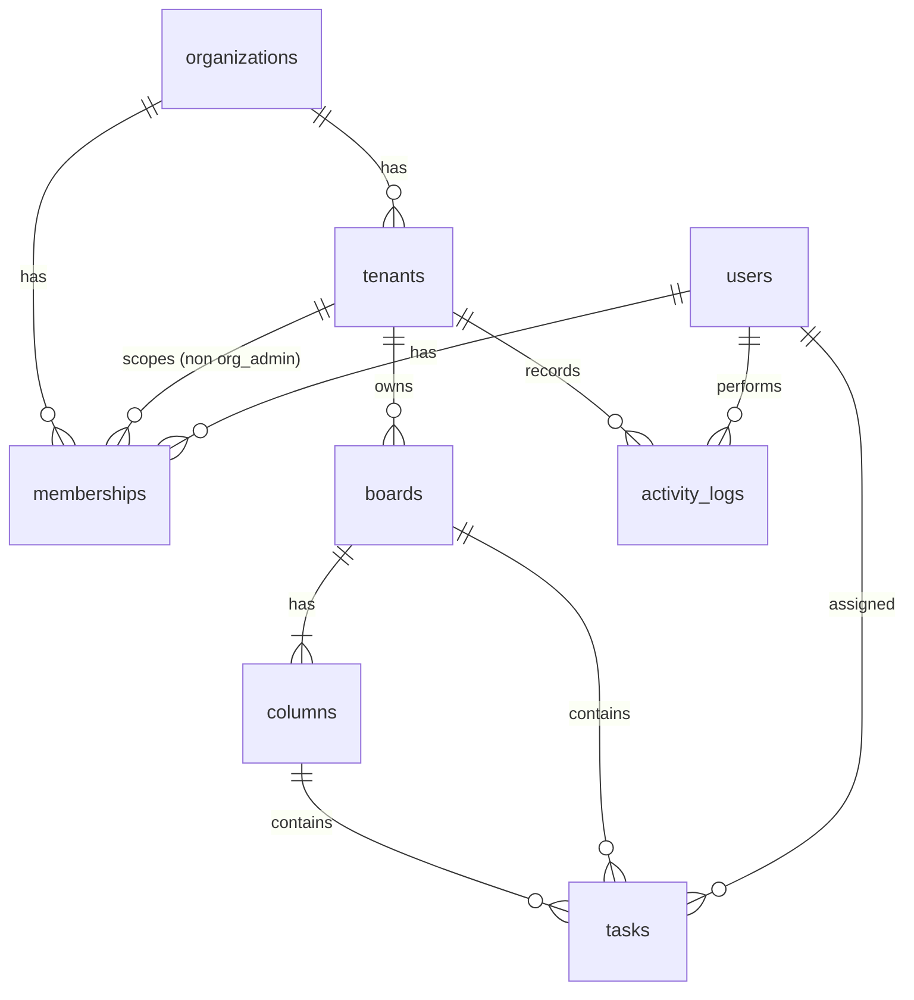

# Entity-Relationship Architecture & Schema

## Entity-Relationship Diagram

---

## Composite Foreign Keys & Tenant Isolation Guarantee

In this architecture, every tenant-scoped table (`boards`, `columns`, `tasks`, `activity_logs`, `processed_actions`) explicitly carries a `tenant_id` column. Cross-tenant references are strictly prohibited at the database engine level via **composite foreign keys**:

1. **`tenants` table**:
   - `UNIQUE (id, organization_id)`

2. **`memberships` table**:
   - `FOREIGN KEY (tenant_id, organization_id) REFERENCES tenants(id, organization_id) ON DELETE CASCADE`
   - Check constraint ensures: `(role = 'org_admin' AND tenant_id IS NULL) OR (role <> 'org_admin' AND tenant_id IS NOT NULL)`

3. **`boards` table**:
   - `FOREIGN KEY (tenant_id, organization_id) REFERENCES tenants(id, organization_id) ON DELETE CASCADE`
   - `UNIQUE (id, tenant_id)`

4. **`columns` table**:
   - `FOREIGN KEY (board_id, tenant_id) REFERENCES boards(id, tenant_id) ON DELETE CASCADE`
   - `UNIQUE (id, tenant_id)`
   - `UNIQUE (id, board_id)`
   - `UNIQUE (board_id, key)`

5. **`tasks` table**:
   - `FOREIGN KEY (board_id, tenant_id) REFERENCES boards(id, tenant_id) ON DELETE CASCADE`
   - `FOREIGN KEY (column_id, board_id) REFERENCES columns(id, board_id) ON DELETE CASCADE`

### Impossible Cross-Tenant Links
Because the foreign key on `tasks` binds `(board_id, tenant_id)` together to `boards(id, tenant_id)`, and `(column_id, board_id)` to `columns(id, board_id)`, it is mathematically impossible for a task in Branch A to reference a column or board in Branch B. The PostgreSQL engine rejects any mismatched tenant foreign keys even if an application bug attempts it.

